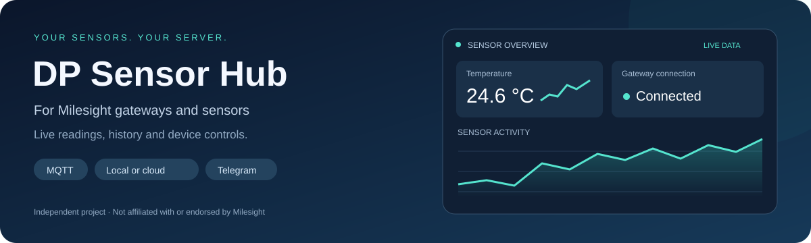
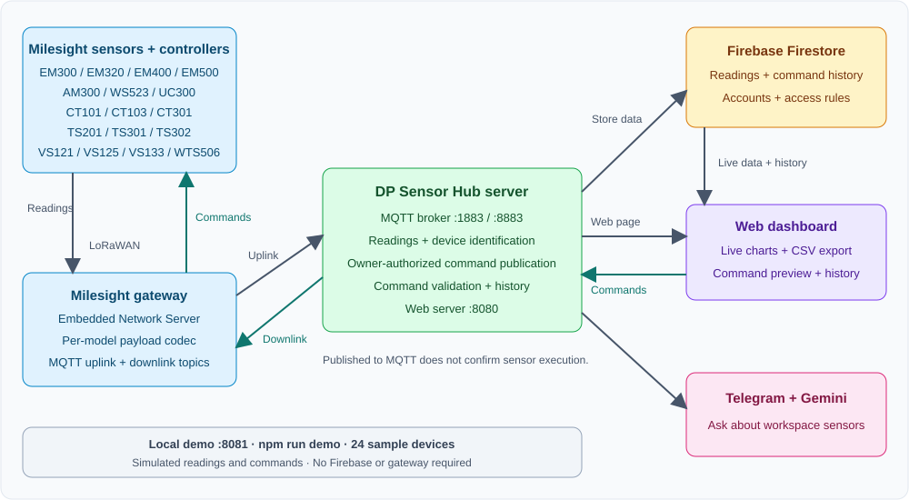
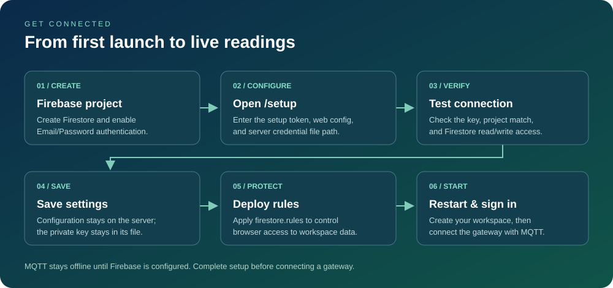
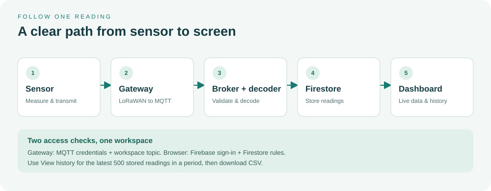
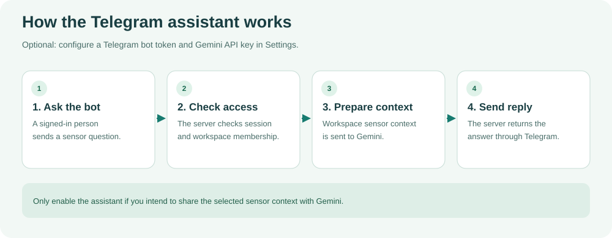
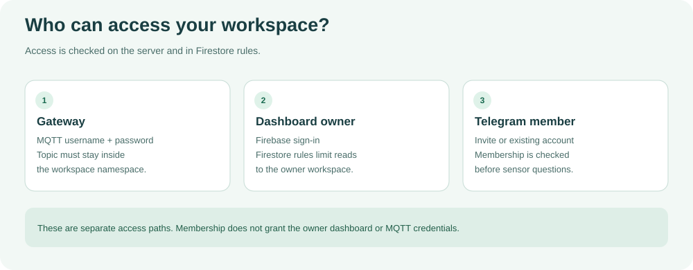
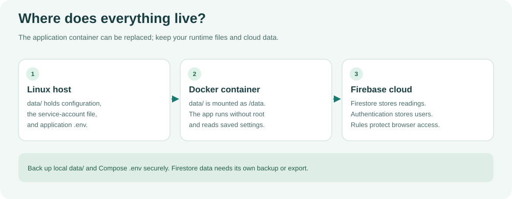

# DP Sensor Hub v2.1.1

<p align="center"></p>

[](https://github.com/dineshpalsingh1989/gateway-dashboard/actions/workflows/ci.yml)
[](https://github.com/dineshpalsingh1989/gateway-dashboard/actions/workflows/install-test.yml)
[](https://github.com/dineshpalsingh1989/gateway-dashboard/actions/workflows/package.yml)

[Releases](https://github.com/dineshpalsingh1989/gateway-dashboard/releases) · [Report a bug](https://github.com/dineshpalsingh1989/gateway-dashboard/issues/new/choose) · [Contributing](CONTRIBUTING.md) · [Security](SECURITY.md)

A self-hosted MQTT broker and live dashboard for **Milesight gateways and sensors**, with Firebase cloud or DuckDB local storage and Telegram command buttons or optional Gemini AI.

**DP Sensor Hub is an independent project, not affiliated with or endorsed by Milesight. Milesight is a trademark of its respective owner.**

The GitHub repository is `gateway-dashboard`; installation and demo links below use that address. Existing installation paths, database names, and environment variables remain supported.

**v2.1.1 supports local and cloud operation:** choose **DuckDB on your own server** or **Firebase Firestore in the cloud**. Choose **Telegram command buttons without AI** or **Gemini AI** independently of storage. Settings shows server disk, database size, and memory usage.

| Mode | Data location | Sign-in |
| --- | --- | --- |
| Local (DuckDB) | Docker's mounted data folder on your server | Local email/password accounts; administrator token required for registration |
| Cloud (Firebase) | Your Firebase Firestore project | Firebase Authentication |

Select storage at **/setup**, save, and restart. Switching modes keeps their databases separate and does not migrate existing data. In local mode, Gemini still sends workspace summaries to Google if enabled; command buttons require no AI.

See [CHANGELOG.md](CHANGELOG.md) for changes, validation, and deployment requirements.



The gateway sends readings to the workspace MQTT uplink topic. The server stores
them in local DuckDB or cloud Firestore, and the signed-in dashboard displays live data and history.
Owners can also send commands: dashboard → authenticated server endpoint → MQTT
broker → gateway → sensor.

## What is included

| Feature | Available now |
| --- | --- |
| Local demo | 24 sample devices, charts, CSV export, settings, debug activity, and simulated commands |
| Sensor profiles | 7 existing profiles plus 17 additions covering leaks, water, soil, current, people counting, temperature, tilt, and weather |
| Two-way MQTT | Incoming readings and owner-authorized command publication through Milesight Embedded Network Server |
| Device commands | Hexadecimal/Base64 preview, configurable topic, FPort, confirmation option, and UC300 DO1/DO2 presets |
| Command history | Server-written attempts and publication status, readable only by the workspace owner |
| Live dashboard | Device cards, history charts, CSV downloads, storage usage, and workspace debug stream |
| Storage options | Local DuckDB or cloud Firebase, selected in server setup |
| Telegram | Fixed command buttons without AI, or optional Gemini sensor questions |
| System status | Server disk capacity/free space, DuckDB file size, and memory usage |

## Try the dashboard demo

**[Open the public dashboard demo](https://dineshpalsingh1989.github.io/gateway-dashboard/)**

The GitHub Pages demo runs entirely in your browser. Explore the sample sensors,
charts, CSV export, and simulated device controls without installing anything.
It connects to no real gateway or Firebase project. Reloading resets your changes.

To run the same demo locally:

Use Node.js 22 or 24:

```sh
git clone https://github.com/dineshpalsingh1989/gateway-dashboard.git
cd gateway-dashboard
npm ci
npm run demo
```

Open **http://localhost:8081**. No Firebase configuration or gateway is needed.
Explore the 24 sample devices, open **View history**, or download CSV. In
**Settings → Send a device command**, choose **Pump room controller**, select a
UC300 output preset, review the MQTT preview, and select **Publish command**.
The command appears in **Recent commands** as simulated.

Demo readings and external services are simulated. Changes are temporary and no
radio commands are sent. Set `DEMO_PORT` to use a different local port.

### Publish with GitHub Pages

`npm run build:demo` creates a self-contained `dist/index.html`. The
**Dashboard demo** GitHub Actions workflow builds and publishes this artifact
after changes land on `main`. GitHub Pages must use **GitHub Actions** as its
publishing source. Only the generated static demo is uploaded; server credentials
and runtime files are excluded. GitHub Pages hosts the simulated demo, while real
sensor ingestion and commands require the self-hosted backend described below.

## Install on Linux

```sh
curl -fsSL https://raw.githubusercontent.com/dineshpalsingh1989/gateway-dashboard/main/install.sh | sh
```

The installer installs Docker if needed, starts the dashboard, and prints the setup URL and administrator token. Files are installed under `~/milesight-dashboard`.

## Choose local or cloud storage

Open `/setup`, enter the administrator token, and use **Storage location** to choose **Firebase cloud** or **DuckDB local**. Save and restart the server. In Docker the local database is `~/milesight-dashboard/data/milesight.duckdb` on the host, mounted as `/data/milesight.duckdb`.

Local mode stores accounts, settings, credentials, devices, sensor readings, and command history on this server. Firebase configuration is unnecessary. Register with the administrator setup token and a password of at least ten characters. Local sessions last 24 hours and end on restart. Email password resets and Google/Microsoft sign-in require Firebase mode.

Choose **Command buttons (no AI)** or **Gemini AI** in Telegram Settings, independently of storage. Command mode needs only a Telegram bot token; no Gemini or Ollama is required. Use `/menu` for sensor commands. Owners can use `/system` privately to see server resources. Settings also has **Refresh system status** for disk, memory, and database size. Telegram requires internet, and Gemini mode sends workspace summaries to Google even with local storage.

Switching storage does not migrate data. Each mode retains its own accounts and records. Stop the application before backing up the DuckDB database and WAL, and run one backend process per database file. Existing approximate 1 GB workspace retention still applies. See [v2.1.1 release notes](docs/releases/v2.1.1.md).

## Configure Firebase



1. Create a Firebase project and a Firestore database in Native mode.
2. Enable **Authentication > Email/Password**. Add your dashboard hostname to Authentication's authorized domains. Enable Google or Microsoft sign-in if you plan to use them.
3. Download a service-account JSON key from **Project settings > Service accounts**. Save it on the server as `~/milesight-dashboard/data/serviceAccountKey.json`. Keep it readable only by the container's runtime user; never commit it.
4. Open `http://<server-ip>:8080/setup`. Use HTTPS when accessing setup remotely.
5. Enter the administrator token printed by the installer, then select **Unlock & load settings**.
6. Enter or import the web configuration from **Project settings > General > Your apps**. For Docker, use `./serviceAccountKey.json` as the service-account path: this resolves inside the mounted `/data` directory.
7. Select **Test Firebase connection**, review the results, then **Save configuration**.
8. Deploy the repository's Firestore rules using an installed, signed-in Firebase CLI. Run this from the installation directory:

   ```sh
   firebase deploy --only firestore:rules --project YOUR_PROJECT_ID
   ```

9. Restart the container:

   ```sh
   cd ~/milesight-dashboard
   docker compose restart
   ```

10. Open `http://<server-ip>:8080`, register an account, and create a workspace.

Before configuration is complete, setup remains available and MQTT stays offline. Connection tests check API-key acceptance, service-account project matching, and Firestore write/read/delete access. Browser sign-in, authorized domains, and security rules still need to be verified after restarting.

To change Firebase later, open **Settings > Firebase > Configure Firebase & test connection**, or visit `/setup`. Saving requires a restart to apply changes.

## Connect a Milesight gateway



Copy the connection details from the dashboard's Settings into your gateway's MQTT settings:

| Setting | Value |
| --- | --- |
| Host | Your server address or configured broker domain |
| Port | `1883`, or `8883` when MQTT TLS is configured |
| Username and password | Credentials shown for your workspace |
| Uplink topic | The exact workspace topic shown in Settings, such as `your-workspace_db/uplink` |

Incoming readings appear automatically. Use **View history** to chart up to the latest 500 stored readings in a selected period and download CSV.

For Telegram, enter your bot token and Gemini API key in Settings, run their test buttons, and save. Add members by email and issue their invitation codes from the same page.



## Workspace access



Each gateway uses its workspace MQTT credentials and topic. Owners use Firebase sign-in for dashboard access. Members added by email use the Telegram assistant; membership alone does not grant the owner's dashboard or broker credentials.

## Sensor profiles

Existing profiles: **EM300-TH, EM300-MCS, AM300, WS523, UC300, TS201, and VS121**.
The update adds these 17 named profiles:

| Application | Added models | Readings displayed |
| --- | --- | --- |
| Leak detection | EM300-SLD, EM300-ZLD, EM300-MLD | Leak status and battery |
| Pulse metering | EM300-DI | Pulse count and battery |
| Tank distance | EM400-UDL | Distance and battery |
| Water level | EM500-SWL | Water level and battery |
| Soil monitoring | EM500-SMTC | Temperature, moisture, conductivity, and battery |
| Pipe pressure | EM500-PP | Pressure in kPa and battery |
| Current monitoring | CT101, CT103, CT301 | Current, including three phases for CT301 |
| Visitor counting | VS133, VS125 | Total entries and exits |
| Cold storage | TS301, TS302 | Temperature, dual probes for TS302, and battery |
| Tilt monitoring | EM320-TILT | X/Y/Z angles and battery |
| Weather | WTS506 | Temperature, humidity, wind speed/direction, rainfall, and pressure |

### Payload requirements

Use Milesight's official per-model payload codec on the gateway and forward
decoded JSON fields at the top level or inside `object` / `objectJSON`.
Include `devEUI` to identify the device. Set `deviceProfileName` to the model,
include the model in `deviceName`, or select it manually in Settings.
These additional profiles do not add model-specific raw decoding.
Field names and units should match [sensor-profiles.js](sensor-profiles.js); adapt gateway codec
output if required. The pipe-pressure profile uses kPa; ambient pressure uses hPa.

## Send commands over MQTT

This integration uses the gateway's **Embedded Network Server**. The gateway
subscribes to downlinks while continuing to publish readings to the uplink topic.

1. Connect the gateway using the workspace broker credentials shown in Settings.
2. Set its MQTT **Downlink Data** topic to `YOUR_WORKSPACE_db/downlink/$deveui`, replacing `YOUR_WORKSPACE_db` with your actual workspace label.
3. Open **Settings → Send a device command** and choose a registered device.
4. Match the downlink topic template, choose FPort (default `85`), and set whether to request LoRaWAN confirmation.
5. Choose a UC300 DO1/DO2 preset, or enter a hexadecimal command from the exact device model/firmware manual.
6. Review the topic and Base64 JSON preview, then select **Publish command**.
7. Check **Recent commands** for publication status and the gateway's packet log for radio delivery.

Custom templates must remain within the workspace namespace and contain
`$deveui`. The dashboard converts 1–51 bytes of
hexadecimal command data to Base64 and publishes non-retained MQTT JSON with
`confirmed`, `fport`, and `data`. Regional radio limits may require shorter commands.
UC300 DO1/DO2 presets follow [Milesight's MQTT control guide](https://support.milesight-iot.com/support/solutions/articles/73000514114-how-to-remotely-control-devices-via-mqtt-on-milesight-gateway).
Other devices use custom commands from their exact model/firmware manual.

Commands require a Firebase owner token and a device in that owner's workspace.
Deploy the updated Firestore rules to read the server-written command history.
`published` means accepted by the broker, **not** gateway receipt or sensor
execution. ACK/error notification correlation is not implemented. Class A
devices generally receive queued downlinks after their next uplink. External
network servers such as ChirpStack need a separate integration.

## Run directly with Node.js

Use Node.js 22 or 24, which are checked in CI.

```sh
git clone https://github.com/dineshpalsingh1989/gateway-dashboard.git
cd gateway-dashboard
npm ci
npm start
```

Open `http://localhost:8080/setup` and follow the Firebase steps above. Place the service-account file in this directory, deploy the rules, then restart with `npm start` after stopping the current process.

Optionally copy `.env.example` to `.env` before starting to customize the server.

## Configuration and saved files



For Docker installations, application files live in `data/`:

| File | Purpose |
| --- | --- |
| `data/firebase.local.json` | Saved Firebase setup values |
| `data/serviceAccountKey.json` | Private server credential |
| `data/.env` | Application environment variables and stable setup token |
| `.env` in the installation directory | Compose runtime user/group IDs |

When running directly with Node.js, application files live in the directory where you start the server instead.

Common environment variables:

| Variable | Purpose |
| --- | --- |
| `WEB_PORT`, `MQTT_PORT`, `MQTT_TLS_PORT` | Default ports: `8080`, `1883`, `8883` |
| `FIREBASE_SETUP_TOKEN` | Keep the administrator setup token stable across restarts |
| `FIREBASE_SERVICE_ACCOUNT_PATH` | Override the saved service-account path |
| `VITE_FIREBASE_*` | Override saved Firebase web configuration |
| `BROKER_DOMAIN` | Broker domain used for tenant hostnames |
| `TLS_CERT_PATH`, `TLS_KEY_PATH` | Enable MQTT TLS using certificate and key files |

Environment variables override saved settings. Changing container ports also requires updating the published ports in `docker-compose.yml`. TLS files must be accessible inside the container.

Containers run as a non-root user. For manual Compose installations, create `data/` first and set `MILESIGHT_UID` and `MILESIGHT_GID` in the installation directory's `.env` to its owner's non-root numeric IDs. The installer configures these automatically; root installations use UID/GID 1000. Service-account files added afterward must be readable by that runtime user.

## Update, logs, and backups

Run these commands from `~/milesight-dashboard`:

```sh
docker compose logs --tail 100 -f  # View logs; setup tokens may appear here
docker compose restart           # Apply saved configuration
docker compose down              # Stop the dashboard
```

To update, re-run the installation command. Back up `data/` and the installation directory's `.env` securely before updating. Sensor readings live in Firestore and require a separate Firestore backup or export.

The dashboard's About panel and `/health` report the running version and service status after setup is complete.
